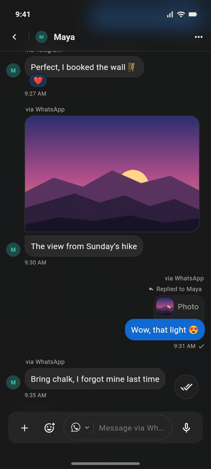
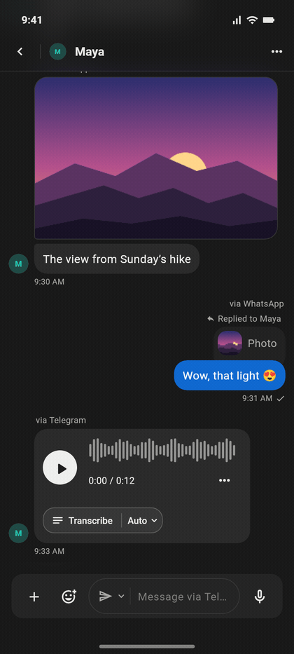
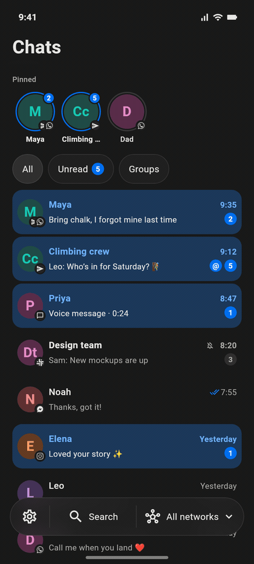
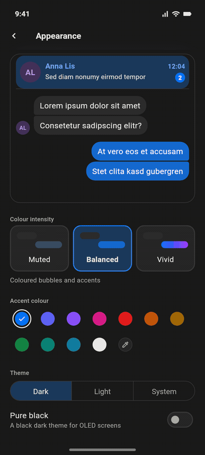
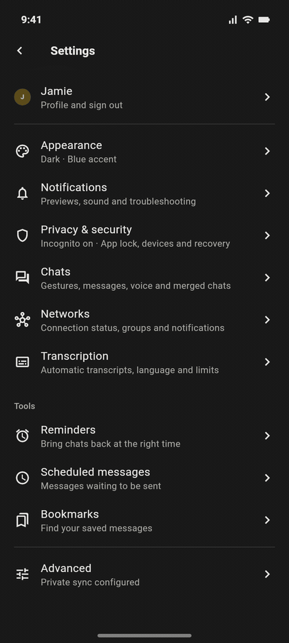

<!--
SPDX-FileCopyrightText: 2019-Present Christian Kußowski
SPDX-FileCopyrightText: 2019-Present Contributors to FluffyChat
SPDX-License-Identifier: AGPL-3.0-or-later
-->

  <picture>
    <source media="(prefers-color-scheme: dark)" srcset="docs/brand/chatloom-lockup-dark.svg">
    <source media="(prefers-color-scheme: light)" srcset="docs/brand/chatloom-lockup-light.svg">
    
  </picture>

  <b>Every chat app. One calm, private inbox.</b> 
  An open-source Beeper client for Android and macOS, built on Matrix and FluffyChat.

  
  
  
  

  

## Why ChatLoom

Your friends are spread over WhatsApp, Telegram, Messenger, Instagram, Signal
and Slack. ChatLoom signs in to your **Beeper** account and puts all of them in
one inbox that feels like a single, well-made app: one look, one set of
gestures, one place to search. Someone who writes to you on two apps becomes
**one conversation**.

It is built to be calm and private. **Incognito is on from the first launch**,
messages stay **end-to-end encrypted**, the local database is encrypted, and
ChatLoom never sends anything you did not send yourself.

## See it move

Every animation below is the app itself: its real Flutter widgets, recorded
frame by frame from a widget test with made-up people and messages
([how](docs/readme/README.md)).

<table>
<tr>
<td width="50%" valign="top" align="center">
 
<b>One inbox, every network</b> 
Network badges on every avatar, pinned chats on top, unread at a glance. The glass dock filters by network in one tap.
</td>
<td width="50%" valign="top" align="center">
 
<b>One person, one conversation</b> 
Maya on WhatsApp and Telegram, in one thread. Long-press for reactions and actions, double-tap for a quick heart.
</td>
</tr>
<tr>
<td width="50%" valign="top" align="center">
 
<b>You choose where it goes</b> 
A merged chat marks the app every message came through. Pick the network for your reply in the composer; typing turns the mic into send.
</td>
<td width="50%" valign="top" align="center">
 
<b>Voice notes as text</b> 
Transcribe any voice note or round video with one tap, or automatically within a daily budget, through your own worker. Only you see the transcript.
</td>
</tr>
<tr>
<td width="50%" valign="top" align="center">
 
<b>Stickers, GIFs and emoji</b> 
One panel for emoji, GIF search and sticker packs imported from Telegram links, with instant local search.
</td>
<td width="50%" valign="top" align="center">
 
<b>Triage with a swipe</b> 
Swipe right to mark read, left to archive (or pin; you choose). The row follows your finger and springs back.
</td>
</tr>
<tr>
<td width="50%" valign="top" align="center">
 
<b>Make it yours</b> 
Eleven accents or any colour you pick, from muted grey to vivid Messenger gradients, light or dark. Everything re-themes live.
</td>
<td width="50%" valign="top" align="center">
 
<b>Incognito by default</b> 
No read receipts, typing or presence until you decide. A chat is marked read only when you do it yourself.
</td>
</tr>
</table>

And there is more:

- Telegram **round videos**: watch, record and send them
- A **photo and video editor** before you send: crop, draw, adjust, trim
- **Send later** and **reminders**, kept by your own worker
- Telegram-style **delivery ticks**, replies and in-chat search
- **Drafts, bookmarks and labels** synced over an encrypted journal
- **Instagram posts, reels and stories** play inside the chat
- **Bridge health**: the app tells you when a network's bridge stops responding

## Highlights

- **Every network you have on Beeper.** WhatsApp, Telegram, Messenger,
  Instagram, Signal, Slack and the rest of Beeper's bridges, filtered from the
  dock. Smart views for Unread, Unanswered, Groups, message requests, Low
  priority and Archive; Beeper's helper bots stay out of the way.
- **Privacy first.** Incognito from the first launch, an HTTP filter that
  blocks automatic read receipts, typing and presence, and *Hide for me* to
  hide a message on this device without deleting it for anyone.
- **End-to-end encrypted.** Matrix encryption unlocked with your recovery key;
  the local store is an encrypted SQLCipher database that is never reset
  silently.
- **Feels native.** A glass dock and headers, spring physics on the things you
  touch, Telegram-style swipe, long-press and predictive back, haptics where
  they help, reduced motion and Battery Saver respected.
- **Yours to run.** Notifications through your own push gateway; sync,
  transcription, reminders and send later through your own worker. Without
  them ChatLoom is still a full chat client.
- **Android and macOS** from one codebase, with the same look and features
  (the Mac has no system notifications).

The full feature tour, everyday tips and the self-hosting overview are in the
**[user guide](docs/GUIDE.md)**.

## Install & deploy

ChatLoom is built from source for now; there are no store releases.

| You want to | Read |
|---|---|
| Set up the toolchain, build and run the tests | [docs/DEVELOPMENT.md](docs/DEVELOPMENT.md) |
| Build and sign the Android app | [android/README.personal.md](android/README.personal.md) |
| Build the macOS app (Apple silicon) | [macos/README.personal.md](macos/README.personal.md) · [docs/macos-client.md](docs/macos-client.md) |
| Run the bridges on your own server | [docs/SELF-HOSTING.md](docs/SELF-HOSTING.md) |
| Run the companion worker (sync, transcription, reminders, send later) | [worker/README.md](worker/README.md) |
| Get Android notifications through your own push gateway | [push-gateway/README.md](push-gateway/README.md) |
| Read the maintainer notes (Polish) | [README.personal.md](README.personal.md) |

Security and privacy: [SECURITY.md](SECURITY.md) · [PRIVACY.md](PRIVACY.md) ·
[CONTRIBUTING.md](CONTRIBUTING.md). The logo, app icons and brand rules are in
[docs/brand/BRAND.md](docs/brand/BRAND.md).

## Credits and license

ChatLoom is a fork of [FluffyChat](https://github.com/krille-chan/fluffychat)
by Christian Kußowski and contributors, and is licensed under the
[AGPL-3.0-or-later](LICENSE) (see [NOTICE.md](NOTICE.md)). It uses the
[Matrix Dart SDK](https://github.com/famedly/matrix-dart-sdk) and talks to
your networks through [Beeper](https://www.beeper.com/)'s bridges. ChatLoom is
not affiliated with Beeper, Meta, Telegram, Signal or Slack.
