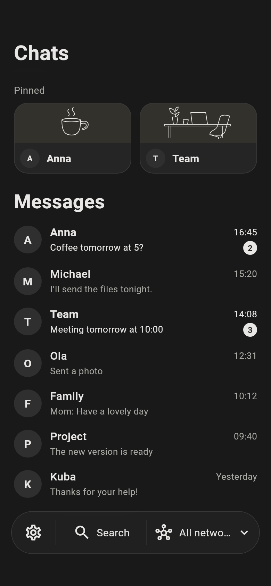
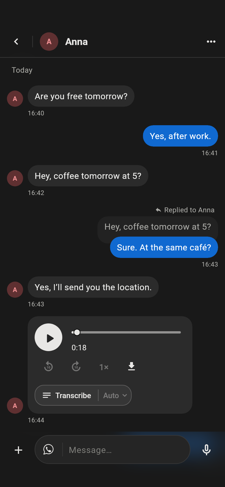
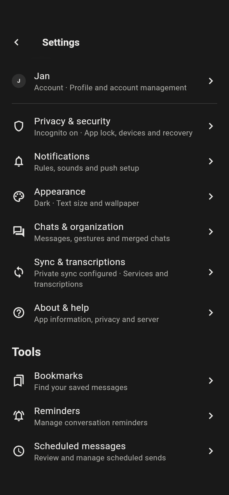

<!--
SPDX-FileCopyrightText: 2019-Present Christian Kußowski
SPDX-FileCopyrightText: 2019-Present Contributors to FluffyChat
SPDX-License-Identifier: AGPL-3.0-or-later
-->

# ChatLoom

All your chats in one calm, private place. ChatLoom brings WhatsApp, Telegram, Signal, Messenger and your other Beeper conversations into a single inbox on your phone and your Mac.

  
  
  

## What you get

- **One inbox for everything.** Filter by network, pin what matters, add private labels, and merge one person's chats from different apps into a single thread.
- **Full conversations.** Replies, reactions, voice notes, photos, files and Telegram round videos. You always see which network a message goes out through.
- **Voice messages as text.** Read a voice note instead of listening to it.
- **Tools that save time.** Drafts that follow you between devices, bookmarks, reminders and messages scheduled for later.
- **Privacy by default.** Messages stay end‑to‑end encrypted and are stored securely on your device.
- **Phone and desktop alike.** Android and macOS share the same look and features.

## Getting started

1. Install ChatLoom on Android or macOS.
2. Sign in with your Beeper account.
3. Enter your recovery key to unlock your encrypted message history.
4. On Android, allow notifications when asked. Everything else sets itself up.

## Everyday use

**Organising chats.** The bar at the bottom of the inbox switches between chat types and networks. Telegram groups land in *Groups*. Chats you never want to see go to *Ignored* (hidden and fully silent). Messages from Beeper's helper bots are kept in *Technical*. You can change the rules in **Settings → Chats & organization → Networks & chat rules** or for a single chat in its details.

**Notifications.** Each chat can be set to *All messages*, *Mentions only* or *Muted*. If notifications stop arriving, open **Settings → Notifications → Push setup & registration** and tap retry.

**Incognito.** New installs start in Incognito: others won't see when you've read their messages, when you're typing or whether you're online. A chat is marked as read only when you do it yourself. You can turn Incognito off in **Settings → Privacy**.

**Transcription.** Tap the transcribe button on a voice message to get its text. You can also have incoming voice and round messages transcribed automatically in **Settings → Sync & transcriptions**. Transcripts are only for you; the sender never sees them. Disappearing messages are never transcribed.

**Reminders and scheduled messages.** Long‑press a message to bookmark it, set a reminder, or write a reply and choose *Send later*. You'll find all of them under **Settings → Tools**.

**Appearance.** Dark by default, with a light mode, eight accent colours and support for larger system text.

## Good to know

- ChatLoom never sends a message on its own — only you do.
- Sync, transcription and reminders use a companion service. **Settings → Sync & transcriptions** shows whether it's online.
- On a Mac, new messages arrive only while ChatLoom is open, and there are no system notifications.
- What you can do in a chat (reactions, edits, voice) depends on what the original network supports.

## Bridges and self-hosting

ChatLoom works with any Beeper account. Some features need bridges you run yourself with Beeper's [Bridge Manager](https://github.com/beeper/bridge-manager): Telegram round videos and GIF search, and Instagram links that play in the app. **[Self-hosting ChatLoom](docs/SELF-HOSTING.md)** walks through the whole setup.

| Network | Bridge |
|---|---|
| Telegram | [chatloom-telegram-bridge](https://github.com/siudajakub/chatloom-telegram-bridge) — fork of mautrix-telegram with round videos, GIF search and sticker formats |
| Instagram | [chatloom-instagram-bridge](https://github.com/siudajakub/chatloom-instagram-bridge) — fork of mautrix-meta with native link previews for posts, reels and stories |
| WhatsApp | [mautrix/whatsapp](https://github.com/mautrix/whatsapp) (official) |
| Messenger | [mautrix/meta](https://github.com/mautrix/meta) (official) |
| Slack | [mautrix/slack](https://github.com/mautrix/slack) (official) |
| Others | [official Beeper bridges](https://github.com/beeper/bridge-manager#official-bridge-list) |
