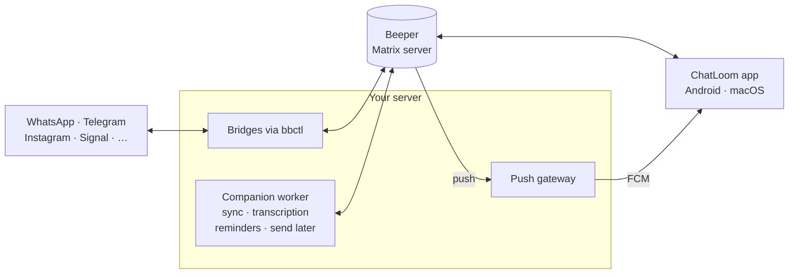

<!--
SPDX-FileCopyrightText: 2019-Present Christian Kußowski
SPDX-FileCopyrightText: 2019-Present Contributors to FluffyChat
SPDX-License-Identifier: AGPL-3.0-or-later
-->

# ChatLoom user guide

What ChatLoom does, what it needs and how to use it day to day. The short
tour with animations is the [README](../README.md).

ChatLoom signs in to your **Beeper account** and shows WhatsApp, Telegram,
Messenger, Instagram, Signal, Slack and your other bridged networks in one
inbox. It can replace the Beeper app on your phone and your Mac. It also adds
what Beeper doesn't have: Telegram round videos, GIF search, sticker packs,
voice-message transcription, scheduled messages and reminders.

## Everything you use Beeper for

- **One inbox for every network.** The floating dock filters by network. Pin
  the chats that matter, add private labels, and merge one person's chats from
  different apps into a single thread.
- **Smart folders.** Groups, Unanswered, Message requests, Low priority and
  Archive. *Ignored* chats are hidden and fully silent. Beeper's helper bots go
  to *Technical*.
- **Full conversations.** Replies, reactions, voice notes, photos, files and
  in-chat search. You always see which network a message goes out through, and
  Telegram-style ticks show when it arrived.
- **End-to-end encryption.** Matrix encryption is unlocked with your recovery
  key. Local data lives in an encrypted SQLCipher database that is never reset
  silently.
- **Notifications** on Android through your own push gateway. Each network or
  chat can be set to *All messages*, *Mentions only* or *Muted*.
- **Phone and desktop alike.** Android and macOS share the same look and
  features.

## …and what Beeper doesn't do

- **Round videos and voice as text.** Watch, record and send Telegram round
  videos. Transcribe any voice note or round video with one tap, or
  automatically within a daily budget. Only you see the transcript.
- **GIFs and stickers.** Search GIFs right in the composer. The search goes
  through Telegram's `@gif` and your own bridge. Import sticker packs from
  `t.me/addstickers` links. An emoji picker is built in.
- **Send later and reminders.** Write now and deliver tomorrow morning.
  Bookmark messages. Set a reminder on a chat, optionally only if they don't
  reply. Your own worker keeps the schedule, so it runs with your phone off.
- **Make it yours.** Dark, light or pure black, eleven accent presets or any
  colour you pick, from muted grey to vivid Messenger gradients. Adjust inbox density, message text
  size, bubble shape and reduced motion.

More that comes with it:

- **Incognito by default.** Others don't see when you read, type or are online.
  A chat is marked as read only when you do it yourself.
- **Instagram posts, reels and stories** play inside the chat (needs the
  ChatLoom Instagram bridge).
- **Drafts follow you** between devices over an encrypted private journal.
- **Hide for me.** Hide a message on this device only, without deleting it for
  anyone.
- **HD photos** on request. Large videos are cached on disk encrypted, and
  files open in their default app.
- **Bridge health.** The app tells you when a network's bridge stops
  responding.

ChatLoom never sends a message on its own. Only you do.

## Getting started

1. Install ChatLoom on Android or macOS. For now you build it from this
   repository; see [Building from source](#building-from-source).
2. Sign in with your Beeper account.
3. Enter your recovery key to unlock your encrypted message history.
4. On Android, allow notifications when asked.

Everything that works with your Beeper account works right away. Some extras
need services you host yourself:

| Feature | Needs |
|---|---|
| Round videos, GIF search | [ChatLoom Telegram bridge](https://github.com/siudajakub/chatloom-telegram-bridge) |
| Instagram media in chat | [ChatLoom Instagram bridge](https://github.com/siudajakub/chatloom-instagram-bridge) |
| Sync of drafts, bookmarks and labels; transcription; reminders; send later | Companion worker ([`worker/`](../worker/)) |
| Android notifications | Push gateway ([`push-gateway/`](../push-gateway/)) |

Without them ChatLoom still works as a full chat client. The features that are
missing show as unavailable.

## Everyday use

**Organising chats.** The bar at the bottom of the inbox switches between chat
types and networks. Telegram groups land in *Groups*. You can change the rules
in **Settings → Chats & organization → Networks & chat rules**, or for a single
chat in its details.

**Notifications.** If notifications stop arriving, open **Settings →
Notifications → Push setup & registration** and tap retry.

**Incognito.** New installs start in Incognito. Turn it off in **Settings →
Privacy**.

**Transcription.** Tap *Transcribe* on a voice message. Automatic transcription
of incoming voice and round messages is in **Settings → Sync & transcriptions**.
Only your worker sends the audio to OpenAI, using your own API key.
Disappearing messages are never transcribed.

**Reminders and scheduled messages.** Long-press a message to bookmark it. Set
a reminder for a chat from its ••• menu. To schedule a reply, write it, then
long-press send and choose *Send later*. You'll find all of them under
**Settings → Tools**.

**On a Mac**, new messages arrive only while ChatLoom is open, and there are no
system notifications. What you can do in a chat (reactions, edits, voice)
depends on what the original network supports.

## Self-hosting

Your Matrix account and encrypted history stay on beeper.com. Everything
ChatLoom adds runs on a Linux server you control:



| Part | How it runs | Guide |
|---|---|---|
| Bridges | Beeper's [Bridge Manager (`bbctl`)](https://github.com/beeper/bridge-manager) runs one process per network, kept alive by a systemd template | [Self-hosting ChatLoom](SELF-HOSTING.md) |
| Companion worker (optional) | A native Dart bundle: `enroll` → `check` → `run`, with a systemd unit | [worker/README.md](../worker/README.md) |
| Push gateway (optional, Android) | A small Python service on loopback, behind your HTTPS reverse proxy, with your own Firebase project | [push-gateway/README.md](../push-gateway/README.md) |

There are no Docker images or compose files yet. Every part runs as a native
process under systemd. **[SELF-HOSTING.md](SELF-HOSTING.md)** covers the whole
setup, from a fresh server to connected accounts.

### Bridges

| Network | Bridge |
|---|---|
| Telegram | [chatloom-telegram-bridge](https://github.com/siudajakub/chatloom-telegram-bridge), a fork of mautrix-telegram with round videos, GIF search and sticker formats |
| Instagram | [chatloom-instagram-bridge](https://github.com/siudajakub/chatloom-instagram-bridge), a fork of mautrix-meta with native previews for posts, reels and stories |
| WhatsApp | [mautrix/whatsapp](https://github.com/mautrix/whatsapp) (official) |
| Messenger | [mautrix/meta](https://github.com/mautrix/meta) (official) |
| Slack | [mautrix/slack](https://github.com/mautrix/slack) (official) |
| Others | [official Beeper bridges](https://github.com/beeper/bridge-manager#official-bridge-list) |

## Building from source

ChatLoom pins Flutter 3.47.4. For Android you supply your own Firebase config
and signing key. The push gateway address is set at build time:

```sh
flutter pub get --enforce-lockfile
flutter build apk --release --target-platform android-arm64 \
  --dart-define=CHATLOOM_PUSH_GATEWAY=https://push.example.org
```

The toolchain, build settings and tests are in
[DEVELOPMENT.md](DEVELOPMENT.md). The macOS build is in
[macos-client.md](macos-client.md).
